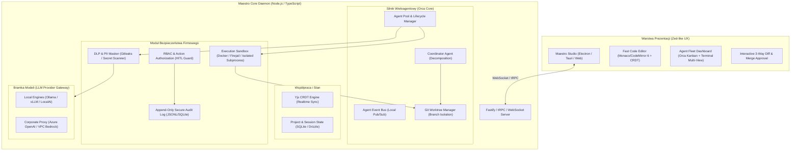

# Maestro: Architektura i Plan Implementacji
> Hybrydowe środowisko programistyczne nowej generacji łączące ergonomię i responsywność **Zed** z orkiestracją wieloagentową **Orca**, zaprojektowane pod kątem rygorystycznych wymogów bezpieczeństwa sieci firmowych (On-Premises / Air-Gapped).

---

## 1. Wstęp i Geneza Projektu

Współczesna inżynieria oprogramowania przechodzi transformację od pojedynczych asystentów czatu (Copilot/ChatGPT) do **autonomicznych zespołów agentów AI (Multi-Agent Systems)** pracujących równolegle nad złożonymi zadaniami. 

**Maestro** łączy dwa kluczowe paradygmaty:
1. **Zed (Editor & Collaboration Benchmark):**
   - Błyskawiczny, minimalistyczny interfejs zoptymalizowany pod kątem braku opóźnień (zero-latency feel).
   - Współpraca w czasie rzeczywistym oparta o CRDT (Conflict-free Replicated Data Types).
   - Wbudowany panel asystenta z precyzyjnym zarządzaniem kontekstem (LSP, symbole, pliki, commity).
2. **Orca (Multi-Agent Fleet & Isolation Benchmark):**
   - Równoległa orkiestracja floty agentów (Agent Development Environment – ADE).
   - Izolacja agentów w niezależnych gałęziach i katalogach roboczych (**Git Worktrees**), eliminująca konflikty i nadpisywanie plików.
   - Architektura ról: *Koordynator / Architekt* planuje i dzieli zadania, *Agenci Domenowi* (Frontend, Backend, Tester, Reviewer) realizują je równolegle.
   - Wizualna inspekcja postępu, podgląd zmian (diff viewer) oraz kontrola człowieka w pętli (*Human-in-the-Loop*).
3. **Enterprise Air-Gapped Security:**
   - Praca w sieciach izolowanych / intranetach bez wycieku kodu na zewnątrz.
   - Wsparcie dla lokalnych modeli (Ollama, vLLM, LocalAI) lub dedykowanych korporacyjnych bramek (Azure OpenAI Private Endpoints, AWS PrivateLink).
   - Moduł DLP (Data Loss Prevention), skanowanie sekretów i restrykcyjne piaskownice (sandboxing) dla komend shellowych.

---

## 2. Architektura Systemu

System zaprojektowany jest w oparciu o architekturę **Klient-Serwer (Local Daemon / Enterprise Server)** w technologii **Node.js (TypeScript)**.



---

## 3. Kluczowe Elementy Architektury

### 3.1. Hybryda Orca + Zed

| Cecha | Źródło inspiracji | Implementacja w Maestro |
|---|---|---|
| **Izolacja pracy agentów** | Orca | Każdy agent tworzy i działa w osobnym **Git Worktree** (`.maestro/worktrees/<task-id>`), nie dotykając gałęzi roboczej programisty do momentu zatwierdzenia. |
| **Pulpit floty agentów** | Orca | Tablica Kanban zadań podagentów, równoległe terminale na żywo, wskaźniki zużycia tokenów i postępu. |
| **Szybkość edycji i CRDT** | Zed | Lekki edytor tekstowy oparty na **CodeMirror 6 / Monaco** zintegrowany z **Yjs**; programista widzi pisanie kodu przez agenta w czasie rzeczywistym z możliwością natychmiastowej korekty. |
| **Głęboki kontekst kodu** | Zed | Integracja z protokołem **LSP (Language Server Protocol)** uruchamianym lokalnie w Node.js, dającym agentom dostęp do definicji typów, błędów składniowych i nawigacji. |
| **Human-in-the-Loop** | Orca + Zed | Tryb półautonomiczny: agent proponuje commity i diffy; deweloper jednym skrótem klawiszowym akceptuje, modyfikuje lub odrzuca zmiany. |

---

### 3.2. Bezpieczeństwo w Sieci Firmowej (Enterprise Intranet)

Bezpieczeństwo jest fundamentem projektu Maestro dla zastosowań korporacyjnych:

1. **Zero External Data Leakage (Air-Gapped Ready):**
   - Domyślny tryb działania bez dostępu do otwartego internetu.
   - Całość komunikacji z modelami odbywa się wewnątrz sieci korporacyjnej (np. `http://ollama-cluster.internal:11434` lub prywatny endpoint Azure AI Foundry / AWS Bedrock VPC).
2. **Lokalna Ochrona Przed Wyciekiem Danych (DLP & Secret Scanner):**
   - Weryfikacja każdego promptu i payloadu narzędziowego przed przekazaniem do modelu.
   - Wykrywanie i maskowanie kluczy API, haseł, tokenów JWT, adresów IP i numerów kart/PESEL przed wysłaniem zapytania do LLM.
3. **Bezpieczne Środowisko Wykonawcze (Execution Sandboxing):**
   - Agenci wykonują polecenia bash/systemowe wyłącznie w kontenerach Docker, systemd-nspawn lub procesach izolowanych chroot/firejail z montowaniem tylko dedykowanego worktree w trybie copy-on-write.
   - Czarna lista niebezpiecznych poleceń (np. `curl` na zewnątrz, modyfikacja plików systemowych, `rm -rf /`).
4. **Niezmienialny Dziennik Audytowy (Immutable Audit Trail):**
   - Każde wywołanie narzędzia, odczyt pliku, wykonanie komendy i odpowiedź modelu jest logowana do pliku audytowego ze sumą kontrolną HMAC.

---

### 3.3. Silnik Wieloagentowy (Multi-Agent System)

1. **Koordynator (Planner Agent):**
   - Przyjmuje zadanie wysokiego poziomu (np. GitHub Issue, wymaganie biznesowe).
   - Generuje plan w postaci DAG (Directed Acyclic Graph) z zależnościami między podzadaniami.
2. **Wyspecjalizowani Agenci (Worker Agents):**
   - **Research / Context Agent:** Analizuje bazę kodu za pomocą indeksu symboli (AST/LSP) i semantycznego wyszukiwania (SQLite-vec / Embeddings lokalne).
   - **Backend / Logic Agent:** Implementuje logikę w odizolowanym worktree.
   - **Frontend / UI Agent:** Przygotowuje komponenty i widoki.
   - **QA / Test Agent:** Uruchamia testy jednostkowe/integracyjne w piaskownicy i zgłasza usterki z powrotem do agenta programisty.
   - **Reviewer / Security Agent:** Przeprowadza statyczną analizę kodu (lintery, audyt bezpieczeństwa) przed scaleniem gałęzi.
3. **Arbiter Scalania (Merge Coordinator):**
   - Automatycznie rozwiązuje proste konflikty i przedstawia użytkownikowi interaktywny 3-kierunkowy podgląd zmian (3-way merge diff).

---

## 4. Stos Technologiczny

- **Runtime:** Node.js 22 LTS (z natywnym wsparciem dla TypeScript i WebSocketów)
- **Język:** TypeScript (Strict mode, Type-safety end-to-end)
- **Serwer & API:** Fastify + tRPC / WebSocket dla ultra-niskich opóźnień
- **Współpraca w czasie rzeczywistym:** Yjs (CRDT) + y-websocket
- **Edytor i UI:**
  - Frontend: React / Vite lub Solid.js (lekki, wysoka wydajność renderowania)
  - Silnik edycji: CodeMirror 6 lub Monaco Editor z rozszerzeniami Zed-like
  - Desktop: Tauri v2 lub Electron (Tauri rekomendowane ze względu na mniejszy narzut pamięci i bezpieczeństwo)
- **Baza Danych & Stan Lokalny:** SQLite (poprzez `better-sqlite3` i `drizzle-orm`) + `sqlite-vec` (dla lokalnych wektorów/RAG)
- **Integracja Narzędzi Deweloperskich:**
  - Git: `simple-git` lub `isomorphic-git` + natywne polecenia worktree
  - Terminal: `node-pty` do obsługi interaktywnych sesji terminala dla agentów
  - LSP: Klient Language Server Protocol w Node.js komunikujący się z lokalnymi serwerami językowymi (tsserver, gopls, rust-analyzer itp.)
- **Izolacja / Sandbox:** Dockerode (kontrola lokalnego demona Docker) / unshare / nsjail

---

## 5. Struktura Projektu (Monorepo)

```
Maestro/
├── apps/
│   ├── desktop/              # Aplikacja okienkowa (Tauri / Electron + React/Solid)
│   └── web/                  # Webowy interfejs dla zespołów (opcjonalny dashboard intranetowy)
├── packages/
│   ├── core/                 # Główny silnik Node.js (Daemon, state, orchestration)
│   ├── agent-runtime/        # Środowisko uruchomieniowe agentów (Worktrees, terminal pty, sandboxing)
│   ├── lsp-client/           # Adapter Language Server Protocol dla ekstrakcji kontekstu
│   ├── security-dlp/         # Moduł ochrony danych, audytu i weryfikacji uprawnień (Enterprise Guard)
│   ├── llm-gateway/          # Klient Ollama, vLLM, OpenAI-compatible proxy z fallbackiem i cache
│   ├── crdt-collab/          # Warstwa synchronizacji Yjs dokumentów i edycji na żywo
│   └── shared/               # Wspólne typy TypeScript, schematy walidacji (Zod)
├── docker/                   # Szablony kontenerów piaskownicy (agent-sandbox)
├── docs/                     # Dokumentacja architektury, przewodniki wdrożeniowe
├── package.json              # Workspace root (pnpm/npm workspaces)
├── tsconfig.json             # Globalna konfiguracja TypeScript
└── README.md
```

---

## 6. Harmonogram i Plan Implementacji (Fazy)

### Faza 1: Fundamenty i Szkielet Rdzenia (Core & Infrastructure)
- [ ] Inicjalizacja monorepo (TypeScript, pnpm/npm workspaces, lintery, testy).
- [ ] Implementacja `packages/llm-gateway`:
  - Obsługa lokalnych providerów: Ollama, vLLM, Text Generation Inference, OpenAI-compatible local proxy.
  - Test połączenia w środowisku izolowanym bez dostępu do sieci zewnętrznej.
- [ ] Implementacja `packages/agent-runtime/worktree`:
  - Automatyczne tworzenie, czyszczenie i zarządzanie odizolowanymi `git worktree` dla każdego zadania.
- [ ] Utworzenie bazowego silnika sesji i bazy danych w SQLite (`better-sqlite3` + Drizzle).

### Faza 2: Silnik Wieloagentowy i Piaskownica (Orca Parity)
- [ ] Architektura agentów: Pętla ReAct/Plan-Execute z agentem koordynatorem i agentami roboczymi.
- [ ] Implementacja wirtualnego terminala (`node-pty`) z logowaniem wejścia/wyjścia.
- [ ] Moduł piaskownicy: uruchamianie poleceń w kontenerze Docker lub z ograniczeniami systemowymi.
- [ ] Moduł narzędziowy dla agentów: odczyt/zapis plików w worktree, uruchamianie testów, linter, git diff.

### Faza 3: Bezpieczeństwo Korporacyjne i Audyt (Enterprise Hardening)
- [ ] Implementacja `packages/security-dlp`:
  - Skanowanie regex/gitleaks pod kątem poufnych danych przed wysłaniem promptu.
  - Animizacja danych wrażliwych.
- [ ] Niezmienialny rejestr audytowy (Audit Trail):
  - Zapis każdej interakcji z modelem i systemem operacyjnym.
- [ ] System uprawnień "Human-in-the-Loop" (potwierdzanie ryzykownych akcji jak modyfikacja konfiguracji czy operacje na bazie).

### Faza 4: Interfejs Użytkownika i Współpraca w Czasie Rzeczywistym (Zed Parity)
- [ ] Klient edycyjny z obsługą CRDT (Yjs + CodeMirror 6/Monaco).
- [ ] Podgląd edycji na żywo: użytkownik widzi kod generowany przez agentów w ich worktree.
- [ ] Interaktywny 3-kierunkowy Diff & Merge:
  - Wizualne porównanie zmian wygenerowanych przez agenta z bieżącą gałęzią dewelopera.
  - Akceptacja jednym kliknięciem / skrótem klawiszowym.
- [ ] Integracja z lokalnym serwerem LSP (diagnostyka kodu, autouzupełnianie, nawigacja po symbolach).

### Faza 5: Testy Wydajnościowe, Dokumentacja i Wdrożenie Intranetowe
- [ ] Testy w izolowanym środowisku air-gapped (odcięty ruch WAN).
- [ ] Przygotowanie obrazów Docker i pakietów instalacyjnych (Docker Compose / Helm chart dla serwera firmowego, instalator desktopowy).
- [ ] Dokumentacja administracyjna wdrożenia w sieci wewnętrznej (zgodność z ISO/IEC 27001, SOC2, RODO).

---

## 7. Weryfikacja Sukcesu i Metryki

1. **Bezpieczeństwo sieciowe:** 0 bajtów wysłanych poza zdefiniowane wewnętrzne IP/domeny firmowe (weryfikacja `tcpdump`/firewallem).
2. **Izolacja agentów:** Równoległa praca minimum 4 agentów na jednym repozytorium bez kolizji w plikach i stanie git.
3. **Responsywność (Zed feel):** Opóźnienie wprowadzania tekstu w edytorze < 16ms (60 FPS), synchronizacja stanu agenta < 50ms w sieci lokalnej.
4. **Wygoda pracy (Orca feel):** Czas od zatwierdzenia planu przez koordynatora do wygenerowania gotowego PR z testami skrócony o min. 60% względem pracy sekwencyjnej.
